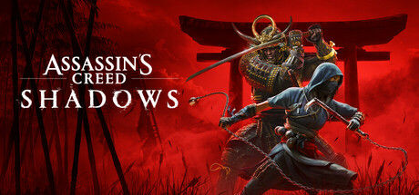

**Assassin's Creed Shadows by Ubisoft Quebec (2024) is set in feudal Japan with dual protagonists: Naoe, a shinobi, and Yasuke, a samurai.**

---

## 📖 About

Assassin's Creed Shadows by Ubisoft Quebec (2024) is set in feudal Japan with dual protagonists: Naoe, a shinobi, and Yasuke, a samurai. It is the first mainline AC game to offer true stealth mechanics alongside brutally satisfying combat, set across one of the most detailed open worlds in series history.

## ⚠️ Problems Without Trainer

| Problem | Status |
|---------|--------|
| Stealth detection radius inconsistent between Naoe and Yasuke missions | ✅ Solved |
| XP grinding required to unlock critical combat skills for hard difficulty | ✅ Solved |
| Resource farming for legendary gear upgrades demands hours in specific regions | ✅ Solved |
| Side activities become repetitive without engaging reward loop variation | ✅ Solved |
| Parkour input misreads cause falls in precise vertical traversal sections | ✅ Solved |

## ✅ Solution

The **Assassin's Creed Shadows Trainer** solves all these issues, giving you complete control so you can focus on enjoying the game.

## 🎯 Features

- Unlimited Resources / Currency
- God Mode / Invincibility
- Instant Skill & Ability Cooldown
- One-Hit Kill
- Freeze Timers
- Unlock All Items & Achievements
- Custom Speed Multiplier
- Infinite Stamina / Energy

## 🚀 Quick Start

1. **Disable Windows Defender** temporarily (trainer may trigger false positive)
2. Get the trainer from the button above
3. Launch Assassin's Creed Shadows
4. Run the trainer as Administrator
5. Use the hotkeys to activate cheats in-game

## 💎 Free vs Pro

| Feature | Free | Pro |
|---------|------|-----|
| God Mode | ✅ | ✅ |
| Unlimited Resources | ✅ | ✅ |
| Advanced Cheats | ❌ | ✅ |
| Auto-Updates | ❌ | ✅ |
| Priority Support | ❌ | ✅ |

## 💻 Requirements

- Windows 10 / 11 (64-bit)
- Assassin's Creed Shadows (any version)
- .NET Framework 4.8+
- DirectX 11+

## 🍎 macOS

## ⚖️ Legal

Educational and single-player use only.

---

